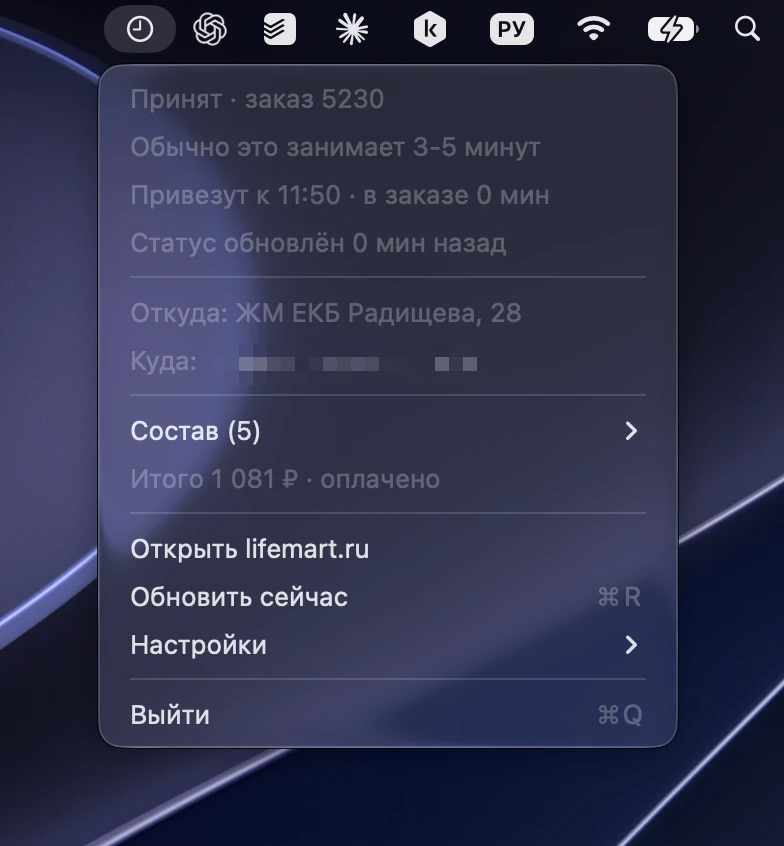

# lifemart-bar

Показывает статус текущего заказа в [Жизньмарте](https://lifemart.ru) в строке меню macOS. Заказываете с телефона, а на ноутбуке видите, собирают заказ или уже везут.



У приложения нет окна и значка в Dock. В строке меню один значок, он меняется вместе со статусом заказа. По клику открывается меню: статус, время доставки, откуда и куда везут, состав и сумма.

| Значок | Статус |
|---|---|
| 🍴 | активного заказа нет |
| 🕒 | заказ принят, собирают |
| 📦 | собрали |
| 🛵 | везут |
| 🛍 | готов к выдаче (самовывоз) |
| ✅ | доставлен |
| ⚠️ | токен не подошел |

При смене статуса приходит уведомление, его можно выключить в меню **Настройки**. Проверить уведомления можно пунктом **Настройки → Тестовое уведомление**. Если вместо него в меню пункт **Разрешить уведомления в macOS…**, уведомления выключены в Системных настройках, и этот пункт откроет нужную страницу.

Пока заказ в работе, приложение проверяет его раз в 30 секунд, без заказа раз в минуту.

## Токен

Приложение запрашивает данные от имени вашего аккаунта, поэтому ему нужны два заголовка из браузера:

1. Войдите в аккаунт на [lifemart.ru](https://lifemart.ru).
2. Откройте инструменты разработчика (⌥⌘I), вкладку **Network**, и обновите страницу.
3. Найдите GET-запрос `profile` к `api.lifemart.ru` и скопируйте из **Request Headers** значения `authorization` и `X-Api-Key`.
4. Вставьте их в приложении: **Настройки → Ввести токен…**

Оба значения хранятся только в связке ключей вашего Mac.

## Сборка

Нужны macOS 14 или новее и Swift 6. Xcode не нужен, хватит Command Line Tools.

```sh
./scripts/make-signing-cert.sh   # один раз
./scripts/bundle.sh
open build/LifemartBar.app
```

`make-signing-cert.sh` создает самоподписанный сертификат в отдельной связке ключей `lifemartbar-signing`. Скрипт сборки подписывает им приложение, и macOS не просит пароль от связки ключей после каждой пересборки. Без сертификата сборка получит одноразовую подпись.

Чтобы запускать приложение из «Программ», скопируйте `build/LifemartBar.app` в `/Applications`.

Иконку рисует `scripts/make-icon.swift`. После правок пересоберите `Resources/AppIcon.icns` командой `./scripts/make-icon.sh`.

## Ограничения

Проект неофициальный и не связан с Жизньмартом. Приложение пользуется тем же API, что и сайт lifemart.ru. Если API изменится, приложение перестанет работать.

Не публикуйте HAR-файлы и токены: по ним можно войти в ваш аккаунт.

## Лицензия

[MIT](LICENSE)
